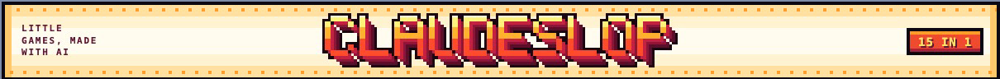
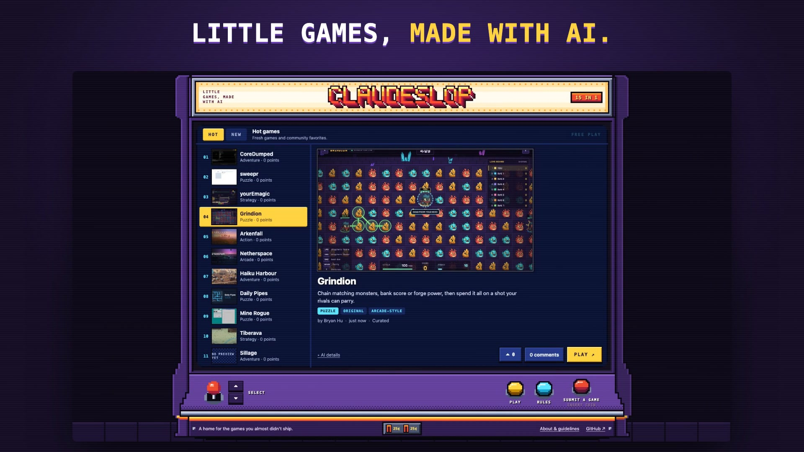

<p align="center"></p>

<h1 align="center">Claudeslop</h1>

<p align="center">
  <a href="https://claudeslop.bryanhu.com/"></a>
  
</p>


<p align="center">
  <a href="https://youtu.be/QiOlB-_Og_E"></a>
  <p align="center"><strong>A directory of little games made with AI.</strong><br>Find something worth playing, share what you made, and leave a comment. No account needed.</p>

</p>


**[Play and browse →](https://claudeslop.bryanhu.com/)**

- Hot and New feeds with game previews and direct Play links.
- Anonymous voting and plain-text comments.
- Tags for genre, game type, and play style.
- Open submissions with creator credits and AI details.

## Run locally

Use Node.js 24. No npm dependencies or external services are needed.

```sh
git clone https://github.com/ThatXliner/claudeslop.git
cd claudeslop
npm start
```

Open [localhost:4317](http://127.0.0.1:4317). The app creates its SQLite database in `data/` and loads the curated games from [seeds.json](seeds.json) on first run. Set `SEED=false` to start with an empty directory.

For development and tests:

```sh
npm run dev
npm test
```

Tests use temporary databases and cover submissions, votes, comments, moderation, and database migrations.

## Add a game

Use **Submit a game** on the [live site](https://claudeslop.bryanhu.com/). Include a playable browser link, a short description, creator credit, and how AI was used. A gameplay preview helps people decide what to try.

For curated additions through the repository, see the [maintainer guide](docs/maintaining.md#curate-games).

## Built with

Node.js, SQLite, and plain HTML, CSS, and JavaScript. One Docker container, with no runtime npm dependencies.

- [Maintainer guide](docs/maintaining.md): configuration, Docker, curation, and moderation.
- [Interface decisions](docs/design.md): design notes and references.
- [Game discovery notes](docs/discovery-2026-10-26.md): sources and creator attribution for the first research batch.

Report broken links or problems through [GitHub issues](https://github.com/ThatXliner/claudeslop/issues/new/choose), or use **Report** on a comment.
